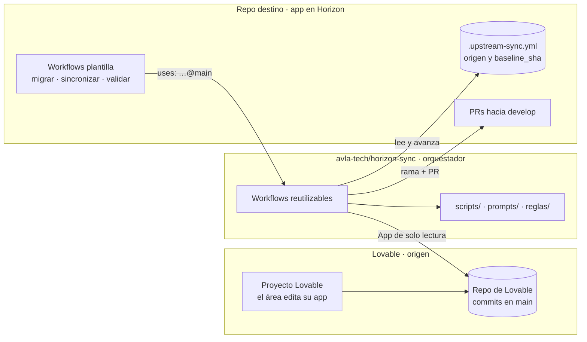
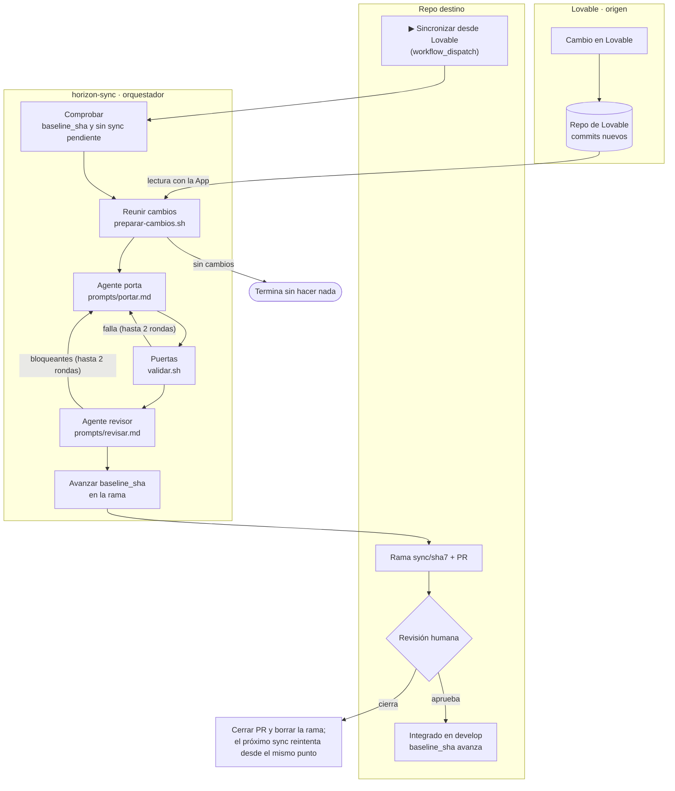
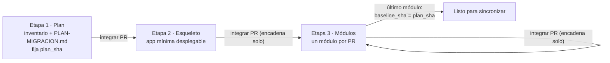
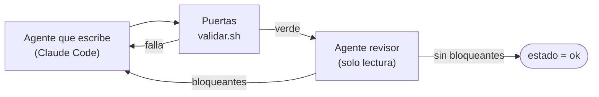

# Horizon Sync · Guía de implementación

> Copia de `docs/IMPLEMENTACION.md` del repo `avla-tech/horizon-sync`. Si cambian los workflows, la versión de referencia es la de ese repo.

Esta guía explica cómo funciona el orquestador, cómo está construido y qué hay que configurar en el
origen (Lovable) y en el destino (Horizon) para enganchar un proyecto.

## Índice

1. [Qué es y qué problema resuelve](#1-qué-es-y-qué-problema-resuelve)
2. [Arquitectura: tres roles](#2-arquitectura-tres-roles)
3. [Flujo de la sincronización incremental](#3-flujo-de-la-sincronización-incremental)
4. [Flujo de la migración inicial](#4-flujo-de-la-migración-inicial)
5. [Cómo está implementado](#5-cómo-está-implementado)
6. [Configuración en el origen (Lovable)](#6-configuración-en-el-origen-lovable)
7. [Configuración en el destino (Horizon)](#7-configuración-en-el-destino-horizon)
8. [Operación del día a día](#8-operación-del-día-a-día)
9. [Seguridad y accesos](#9-seguridad-y-accesos)
10. [Solución de problemas](#10-solución-de-problemas)
11. [Deuda técnica conocida](#11-deuda-técnica-conocida)

---

## 1. Qué es y qué problema resuelve

Las áreas construyen y siguen mejorando sus apps en **Lovable**. Esas apps se migran a **Horizon** y,
desde ahí, cada funcionalidad nueva que se agrega en Lovable había que portarla a mano. Con más áreas y
más proyectos, ese trabajo manual se vuelve el cuello de botella.

**Horizon Sync** es un orquestador en GitHub Actions que:

- **Migra una vez** una app de Lovable a Horizon: plan, esqueleto y módulos, cada uno en su PR.
- **Sincroniza de forma incremental** cada cambio posterior de Lovable: toma solo los commits nuevos,
  los adapta al código de Horizon con agentes de IA (Claude Code) y entrega un PR para revisión humana.

Nada entra a `develop` sin que una persona apruebe el PR.

---

## 2. Arquitectura: tres roles



| Rol | Repo | Qué hace | Qué **no** hace |
|---|---|---|---|
| **Origen** | Repo de Lovable (por ejemplo `aramirez-avla/tax-tidy-hub`) | El área sigue trabajando en Lovable; cada cambio queda como commit | No se modifica nunca desde Horizon Sync |
| **Destino** | Repo de la app en Horizon (`avla-tech/…`) | Tiene 3 workflows cortos que funcionan como botón y guarda el estado en `.upstream-sync.yml` | No tiene lógica propia de migración |
| **Orquestador** | `avla-tech/horizon-sync` | Concentra toda la lógica: workflows, scripts, prompts y reglas de Horizon | No se despliega; no es una app |

Una mejora en el orquestador (una regla nueva, un prompt mejor) llega a **todas las apps a la vez**, sin
tocar cada repo destino.

---

## 3. Flujo de la sincronización incremental



Paso a paso (`.github/workflows/sincronizar.yml`):

1. **Comprobar**: existe `.upstream-sync.yml` con `baseline_sha` (la migración inicial terminó) y no hay
   una rama `sync/*` sin integrar.
2. **Token de lectura**: la GitHub App `avla-lovable-lector` entrega un token efímero limitado al repo de
   Lovable.
3. **Clonar el origen** con la historia completa en `source_branch`.
4. **Reunir cambios** (`scripts/preparar-cambios.sh`): genera en `trabajo/cambios/` los commits nuevos
   (`commits.txt`), un resumen, el diff completo y un parche por commit. Respeta `ignore_paths`. Si no hay
   commits nuevos, el job termina sin hacer nada.
5. **Rama** `sync/<sha7>` en el destino.
6. **Ciclo de agentes** (`scripts/ciclo.sh`): agente que escribe → puertas → agente revisor, con hasta 2
   rondas de corrección (ver [5.3](#53-ciclo-de-agentes)).
7. **Avanzar `baseline_sha`** al último commit del origen, dentro de la misma rama.
8. **Subir la rama y abrir el PR** con los commits, el informe del agente y la revisión automática. Si la
   organización bloquea la creación del PR, el resumen del job deja un link para abrirlo a mano.
9. **Artefacto** `sincronizar-<run_id>` con todo el material de `trabajo/` (30 días).

El estado del PR queda en su título:

| Estado | Título | Significado |
|---|---|---|
| `ok` | `Sync desde Lovable: N commits (hasta abc1234)` | Puertas en verde y revisión sin bloqueantes; falta la revisión humana |
| `puertas_fallan` / `bloqueantes` | `[necesita revisión] Sync desde Lovable: …` | No se resolvió en 2 rondas; requiere atención de una persona |
| `error_agente` | (sin PR) | El agente falló; revisar el log y el artefacto |

---

## 4. Flujo de la migración inicial

La sincronización solo funciona sobre una app ya migrada. La migración se hace **una vez por app**.



| Etapa | Workflow | Cómo se lanza | Entrega |
|---|---|---|---|
| Plan | `migrar-plan.yml` | A mano: `etapa = plan` | PR con `docs/PLAN-MIGRACION.md`, `docs/INVENTARIO-ORIGEN.md` y `.upstream-sync.yml` (con `plan_sha`) |
| Esqueleto | `migrar-esqueleto.yml` | A mano: `etapa = esqueleto` | PR con la app mínima desplegable en Horizon |
| Módulos | `migrar-modulo.yml` | Automático al integrar el PR anterior (o a mano: `etapa = modulo`) | Un PR por módulo; actualiza `modulos_portados` |

Lo que existe en Lovable **antes** de `plan_sha` entra por la migración; **solo lo posterior** entra por
el sync.

---

## 5. Cómo está implementado

### 5.1 Estructura del orquestador

| Ruta | Contenido |
|---|---|
| `.github/workflows/` | Workflows reutilizables (`workflow_call`): `migrar-plan`, `migrar-esqueleto`, `migrar-modulo`, `sincronizar`, `validar-pr`. Además `hola` (prueba de credenciales) y `ci` (lint de este repo) |
| `.github/actions/central/` | Action compuesta que exporta `CENTRAL_DIR` con la raíz de horizon-sync en el runner |
| `scripts/` | `preparar-cambios`, `ciclo`, `validar`, `chequeo-horizon`, `humo-docker`, `inventario`, `planificar`, `siguiente-modulo`, `detectar-stack` |
| `prompts/` | Instrucciones de los agentes: `planificar`, `esqueleto`, `modulo`, `portar`, `corregir`, `revisar`, `revisar-migracion` |
| `reglas/` | Reglas de Horizon (`horizon-general`, `revision-codigo`, `metodologia-migracion`, `traspaso-migracion`) y perfiles por stack (`perfil-node-tanstack-lovable`, `perfil-node-monorepo`, `perfil-python-angular`) |
| `plantillas/` | Workflows para copiar en cada repo destino |

**Por qué la action `central`**: el `GITHUB_TOKEN` del repo que llama no puede clonar horizon-sync
(es privado), pero el runner sí descarga actions de repos de la organización cuyo *Access* lo permite.
La action solo apunta `CENTRAL_DIR` a la carpeta descargada, y desde ahí se usan scripts, prompts y reglas.

### 5.2 Estado: `.upstream-sync.yml`

Vive en la raíz del repo destino y es la única fuente de verdad del sync:

```yaml
# Origen de esta app. Lo mantiene horizon-sync.
source_repo: aramirez-avla/tax-tidy-hub   # repo de Lovable (dueño/nombre)
source_branch: main                       # rama del origen que se sigue
stack: node-tanstack-lovable              # perfil de reglas (reglas/perfil-<stack>.md)
plan_sha: <sha>                           # commit del origen sobre el que se hizo el plan
baseline_sha: <sha>                       # último commit del origen ya sincronizado
modulos_portados: [...]                   # avance de la migración inicial
ignore_paths:                             # rutas del origen que el sync no porta
  - .lovable/
  - src/routeTree.gen.ts
```

- `baseline_sha` **avanza solo al integrar** el PR del sync. Si el PR se cierra sin integrar, el próximo
  sync parte del mismo punto.
- Si hay una rama `sync/*` cuyo `baseline_sha` difiere del de la rama base, el sync se detiene: hay una
  sincronización pendiente.
- Migrar y sincronizar comparten el grupo de concurrencia `migracion`: nunca corren dos a la vez en el
  mismo repo.

### 5.3 Ciclo de agentes

`scripts/ciclo.sh` se usa en el esqueleto, en los módulos y en el sync:



| Pieza | Herramientas | Detalle |
|---|---|---|
| Agente que escribe | `Read, Edit, Write, Glob, Grep` y `Bash` acotado (`npm`, `npx`, `node`, `pip`, `python`, `pytest`, `ruff`, `mypy`, `git diff/status/log/show`, `ls`, `mkdir`) | No puede hacer commit ni push; el script versiona. Máximo 150 turnos |
| Puertas (`validar.sh`) | — | Dependencias, tipos, lint/formato, pruebas, reglas de Horizon (`chequeo-horizon.sh`), secretos (`gitleaks`), imagen y arranque (`humo-docker.sh`) |
| Agente revisor | `Read, Glob, Grep` y `git diff/log/show`, `ls` | Revisa fidelidad al origen, seguridad y pruebas; marca bloqueantes |

Rondas: `MAX_RONDAS = 2` por defecto. Opcionales: `MODELO` para elegir el modelo de Claude.

**Reglas de Horizon que verifican las puertas** (`chequeo-horizon.sh`): `Dockerfile` en la raíz,
`EXPOSE 8080` y `ENV PORT=8080`, `USER 10001`, `HEALTHCHECK` sin `curl`, `ARG` con valor por defecto,
manifiesto de variables (`.env.example`), sin conectores de Lovable y, en TanStack, `NITRO_PRESET=node-server`.

### 5.4 Qué recibe el agente en el sync

El workflow arma `trabajo/contexto.md` con:

- Copia del origen en solo lectura (`origen/`), en el último commit.
- `trabajo/cambios/commits.txt`, `resumen.txt`, `cambios.diff` y `commits/` (un parche por commit).
- `docs/PLAN-MIGRACION.md` del destino, con las decisiones vigentes de la migración.
- Reglas generales, del stack y de revisión de código.

El agente porta **la intención** del cambio, adaptada a cómo quedó la app en Horizon; no aplica el diff tal cual.

---

## 6. Configuración en el origen (Lovable)

Se hace una vez por proyecto.

1. **Conectar el proyecto de Lovable a GitHub** desde el workspace de Lovable. Lovable crea el repo y
   sube cada cambio como commit en `main`.
2. **Dar acceso a la GitHub App de lectura** (`avla-lovable-lector`) sobre ese repo:
   - La App está instalada en la cuenta u organización donde viven los repos de Lovable.
   - En la instalación, agregar el repo a *Repository access*.
   - Permisos de la App: **Contents: Read** (y *Metadata: Read*, obligatorio). Nada de escritura.

No se agregan archivos ni workflows al repo de Lovable.

---

## 7. Configuración en el destino (Horizon)

Se hace una vez por app.

### 7.1 Repo

1. Crear el repo en `avla-tech` con **`develop` como rama por defecto**.
2. Confirmar que `avla-tech/horizon-sync` tenga *Settings → Actions → Access* en
   "Accessible from repositories in the organization" (se configura una sola vez en horizon-sync).

### 7.2 Secretos

En *Settings → Secrets and variables → Actions* del repo destino:

| Secreto | Qué es |
|---|---|
| `LECTOR_APP_ID` | ID de la App de solo lectura |
| `LECTOR_APP_PRIVATE_KEY` | Llave privada (`.pem`) de esa App |
| `CLAUDE_CODE_OAUTH_TOKEN` | Token de `claude setup-token` (plan Team de Avla Tech). Vence al año |

> Las credenciales las carga una persona con acceso; nunca se pegan en chats, issues ni commits.

### 7.3 Workflows

Copiar desde `horizon-sync/plantillas/` a `.github/workflows/` del destino, en `develop`:

| Plantilla | Para qué | Qué editar |
|---|---|---|
| `prueba-horizon-sync.yml` (opcional) | Probar credenciales antes de migrar | `origen: <dueño>/<repo-lovable>` |
| `migrar.yml` | Migración inicial (plan, esqueleto, módulos) | En el job `plan`: `origen: <dueño>/<repo-lovable>`. Opcional: `rama_origen` |
| `sincronizar.yml` | Botón del sync incremental | Nada: lee el origen de `.upstream-sync.yml` |
| `validar.yml` | Puertas en cada PR hacia `develop` | Nada |

Ejemplo del job `plan` en `migrar.yml`:

```yaml
  plan:
    if: github.event_name == 'workflow_dispatch' && inputs.etapa == 'plan'
    uses: avla-tech/horizon-sync/.github/workflows/migrar-plan.yml@main
    with:
      origen: aramirez-avla/tax-tidy-hub
      # rama_origen: main   # opcional; por defecto main
    secrets: inherit
```

### 7.4 Checklist de enganche

- [ ] Proyecto de Lovable conectado a GitHub
- [ ] App `avla-lovable-lector` con acceso al repo de Lovable
- [ ] Repo destino en `avla-tech` con `develop` por defecto
- [ ] 3 secretos cargados en el destino
- [ ] Plantillas copiadas en `.github/workflows/` y `origen` editado en `migrar.yml`
- [ ] (Opcional) `prueba-horizon-sync.yml` en verde
- [ ] Migración: plan → esqueleto → módulos integrados (queda `baseline_sha`)
- [ ] Primer sync lanzado

---

## 8. Operación del día a día

**Migrar una app nueva**

1. *Actions → Migrar → Run workflow* con `etapa = plan`. Revisar e integrar el PR del plan.
2. Lanzar con `etapa = esqueleto`. Revisar e integrar el PR.
3. Los módulos se encadenan solos: cada vez que se integra un PR de esqueleto o módulo, parte el siguiente.
   El último módulo fija `baseline_sha`.

**Sincronizar**

1. El área hace cambios en Lovable.
2. *Actions → Sincronizar desde Lovable → Run workflow*.
3. Revisar el PR `sync/<sha7>` e integrarlo. Al integrar, `baseline_sha` avanza.

**Qué revisar en un PR de sync**

- Que el cambio respete la intención del commit de Lovable.
- Que la lógica de negocio quede en el backend cuando corresponda, no solo en la interfaz.
- Que las pruebas del origen se hayan portado y pasen en las puertas.
- La sección "Revisión automática" del PR.

**Probar el sync con un cambio que ya está en el origen**

Si el cambio ya estaba en `main` antes de migrar, entraría por la migración y no por el sync. Para probarlo
como incremental: crear en el origen una rama en el commit anterior (por ejemplo `antes-de-logica`), migrar
con `rama_origen: antes-de-logica` y, al terminar, cambiar `source_branch: main` en `.upstream-sync.yml`
antes de lanzar el sync.

---

## 9. Seguridad y accesos

| Actor | Acceso | Cómo se controla |
|---|---|---|
| Repo de Lovable | Solo lectura | GitHub App: token por ejecución, limitado a ese repo; el clon no guarda credenciales (`persist-credentials: false`) |
| Job del destino | Escritura en su repo | `GITHUB_TOKEN` con `contents: write` y `pull-requests: write` |
| Agente que escribe | Edita archivos en el runner | Herramientas acotadas; sin commit ni push |
| Agente revisor | Solo lectura | Sin herramientas de edición |
| Persona | Integra el PR | Nada entra a `develop` sin revisión humana |

Además, `gitleaks` busca secretos en cada entrega.

---

## 10. Solución de problemas

| Síntoma | Causa | Qué hacer |
|---|---|---|
| "Falta .upstream-sync.yml" | El repo no viene de una migración | Ejecutar la migración inicial |
| "no tiene baseline_sha" | La migración no terminó | Integrar el PR del último módulo |
| "Hay una sincronización sin integrar en sync/…" | Quedó una rama de sync anterior | Integrar o cerrar su PR y borrar la rama |
| No se abre el PR automáticamente | La organización bloquea PRs creados por `GITHUB_TOKEN` | Abrirlo desde el link del resumen del job |
| Falla "Pedir token de lectura del origen" | La App no tiene acceso al repo de Lovable o los secretos están mal | Revisar *Repository access* de la App y los secretos |
| Falla al ubicar horizon-sync | *Access* de horizon-sync no permite repos de la organización | Ajustar *Settings → Actions → Access* en horizon-sync |
| Claude responde 401 | `CLAUDE_CODE_OAUTH_TOKEN` vencido | Generar uno nuevo con `claude setup-token` |
| PR con `[necesita revisión]` | Puertas o revisión sin resolver tras 2 rondas | Revisar el log de puertas y la revisión automática; corregir en la rama |
| "Sin cambios nuevos en Lovable" | No hay commits después de `baseline_sha` | Nada que hacer |

El artefacto `sincronizar-<run_id>` (o el de cada etapa de migración) guarda el contexto, los cambios, el
informe y la revisión para diagnosticar.

---

## 11. Deuda técnica conocida

| Pendiente | Por qué importa | Propuesta |
|---|---|---|
| PR automático | La organización bloquea PRs creados por `GITHUB_TOKEN` | GitHub App con permiso de escritura en `avla-tech` |
| Secretos por organización | Hoy se cargan 3 secretos en cada repo destino | Secretos de organización en `avla-tech` |
| Actions en Node 20 | GitHub lo está deprecando en sus runners | Subir versiones de las actions |
| Guía de agentes y WAF | La guía no refleja los cambios del WAF | Actualizar la guía |
| Costo y tiempo por sync | No hay línea base para estimar al escalar | Medir en las próximas pruebas |
